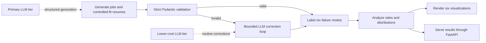
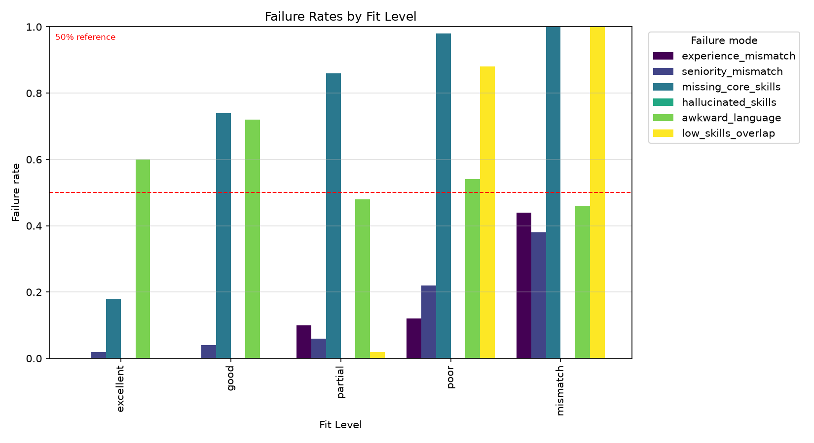
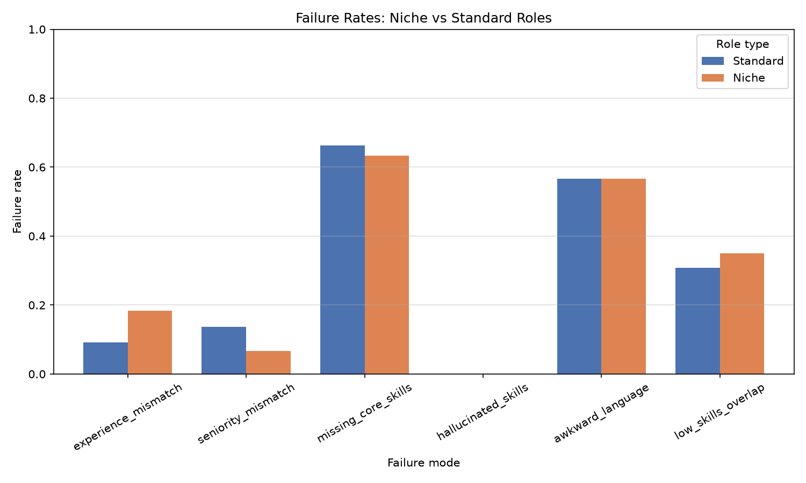
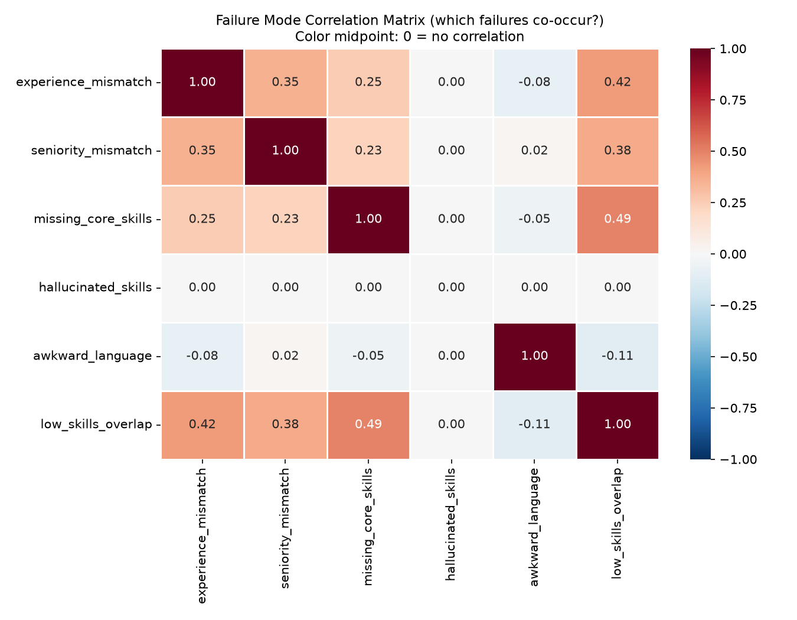
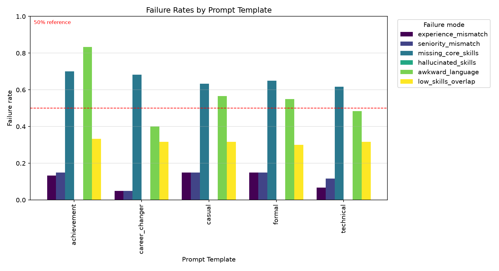

# Resume–Job Synthetic Data Pipeline

> A production-style pipeline for generating, validating, repairing, and evaluating synthetic resume–job pairs.

<p align="center">
  <strong>50</strong> jobs &nbsp;•&nbsp;
  <strong>300</strong> resumes &nbsp;•&nbsp;
  <strong>98.57%</strong> strict validation &nbsp;•&nbsp;
  <strong>6</strong> evaluation visualizations
</p>

This project turns LLM-generated resumes and job descriptions into an auditable evaluation dataset. It uses strict Pydantic schemas, a bounded correction loop, six transparent failure labels, optional LLM-as-judge review, and a FastAPI interface.

**Explore:** [Pipeline](#pipeline) · [Results](#final-production-results) · [Visual evidence](#visual-evidence) · [Quick start](#quick-start) · [API](#api) · [Project map](#project-map)

---

## Pipeline



Each artifact is timestamped. The full runner passes those timestamps forward, so every stage can be traced to one coherent production run.

## Final production results

The final post-improvement run generated **50 jobs**, **300 resumes**, and **300 resume–job pairs** across all five intended fit levels and templates.

| Measure | Result |
| --- | ---: |
| Strict validation | 342 / 350 records (97.71%) |
| Labeled pairs | 300 / 300 |
| Fit-level coverage | 100 / 50 / 50 / 50 / 50 (excellent → mismatch) |
| Manual spot-check agreement | 10 / 10 |
| Optional LLM-judge review latency | 4.421 s |

Five date-format validation failures were repaired on their first attempt, yielding a
100% correction rate. The complete clean-run lineage is generation `20260713_111635`,
validation `20260713_115120`, correction `20260713_121612`, labeling `20260713_121624`,
and summary `20260713_121633`.

## Visual evidence

The evaluation makes expected quality differences visible: failure rates grow as intended fit declines, and niche roles reveal a distinct failure profile.

| Failure rates by controlled fit | Niche versus standard-role failure rates |
| --- | --- |
|  |  |

| Failure correlation matrix | Failure rates by resume template |
| --- | --- |
|  |  |

See all six charts in [`visualizations/`](visualizations/), including the detailed [schema-validation heatmap](visualizations/schema_validation_heatmap.png). Analysis notes are in [`docs/ITERATION_LOG.md`](docs/ITERATION_LOG.md), and manual checks are in [`docs/SPOT_CHECK.md`](docs/SPOT_CHECK.md).

---

## Quick start

```bash
python3 -m venv .venv
source .venv/bin/activate
pip install -r requirements.txt
cp .env.example .env
```

Add a provider key to `.env`. OpenAI, OpenRouter, Groq, and Anthropic are supported;
the final production run used OpenAI `gpt-5.4-mini` for generation, correction, and
the optional judge.

Run the complete pipeline:

```bash
python run_all.py --jobs 50 --resumes-per-job 6
```

Or run individual stages:

```bash
PYTHONPATH=src python -m resume_pipeline.generate --jobs 50 --resumes-per-job 6
PYTHONPATH=src python -m resume_pipeline.validate
PYTHONPATH=src python -m resume_pipeline.correct
PYTHONPATH=src python -m resume_pipeline.labeler
PYTHONPATH=src python -m resume_pipeline.analyze
PYTHONPATH=src python -m resume_pipeline.visualize
```

## API

Start the service:

```bash
PYTHONPATH=src uvicorn resume_pipeline.api:app --port 8000
```

Check health and inspect aggregate failure rates:

```bash
curl http://127.0.0.1:8000/health
curl http://127.0.0.1:8000/analysis/failure-rates
```

`POST /review-resume` accepts schema-valid `resume` and `job` objects. Add `"use_llm_judge": true` to include the optional structured LLM judgment.

## Verify

```bash
PYTHONPATH=src pytest -v
```

## Project map

| Path | Purpose |
| --- | --- |
| `src/resume_pipeline/schemas.py` | Strict Pydantic schemas and validation rules. |
| `src/resume_pipeline/loose_schemas.py` | Permissive generation-time models. |
| `src/resume_pipeline/llm_client.py` | Provider-swappable Instructor client and model tiers. |
| `src/resume_pipeline/prompts.py` | Job, resume, correction, and judge prompts. |
| `src/resume_pipeline/generate.py` | Controlled job, resume, and pair generation. |
| `src/resume_pipeline/validate.py` | Strict validation and error categorization. |
| `src/resume_pipeline/correct.py` | LLM correction loop with retry limit. |
| `src/resume_pipeline/labeler.py` | Six rule-based failure labels. |
| `src/resume_pipeline/judge.py` | Optional structured LLM-as-judge. |
| `src/resume_pipeline/analyze.py` | Summary and failure-rate analysis. |
| `src/resume_pipeline/visualize.py` | Six required PNG visualizations. |
| `src/resume_pipeline/api.py` | FastAPI health, review, and failure-rate endpoints. |
| `run_all.py` | Timestamp-linked end-to-end orchestration. |
| `docs/` | Iteration log, spot-check, and turn-in documentation. |
